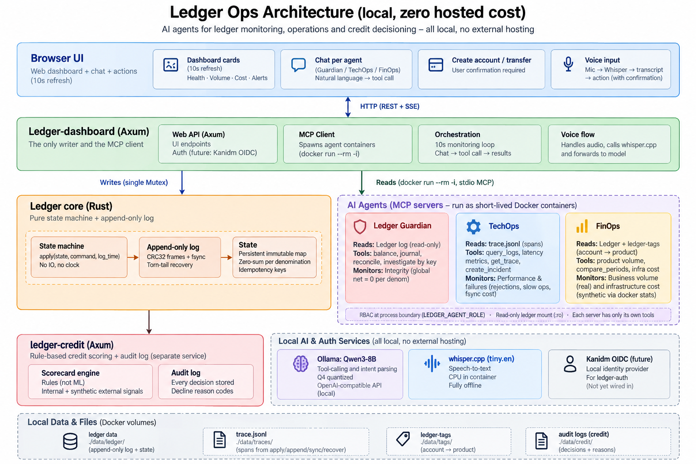

# Ledger Ops Architecture

**Local-first ledger operations with AI agents, zero hosted cost, and no
external model hosting.**

## Overview

-   **Browser UI:** Dashboard cards refresh every 10 seconds; chat per
    agent; account creation and transfers; voice input.
-   **`ledger-dashboard` (Axum):** The only ledger writer and the MCP
    client. It exposes the web API, orchestrates monitoring, and
    launches short-lived agent containers.
-   **Ledger core (Rust):** Pure state machine and append-only, fsynced
    log. The log is the source of truth and supports CRC32 frames and
    torn-tail recovery.
-   **AI agents:** Ledger Guardian checks integrity, TechOps monitors
    performance and failures, and FinOps analyses product volume and
    infrastructure cost. Each runs as a short-lived MCP server over
    stdio with role-scoped tools.
-   **`ledger-credit` (Axum):** Separate rule-based credit scorecard and
    audit-log service; it is not an ML model.
-   **Local AI and auth services:** Ollama with Qwen3-8B for
    tool-calling and intent parsing; `whisper.cpp` `tiny.en` for offline
    speech-to-text; Kanidm OIDC is planned and not yet wired in.
-   **Local data:** Docker volumes hold the ledger, traces,
    account-to-product tags, and credit audit logs.

## AI agent operations

The dashboard runs a monitoring loop every 10 seconds, calling
reconciliation, latency metrics, rejected-log queries, product-volume
metrics, and infrastructure-cost metrics before updating the status
cards. Engineers can also chat with each agent in natural language;
Qwen3 selects from that agent's available tools.

  -----------------------------------------------------------------------
  Agent                   Read scope              Responsibilities
  ----------------------- ----------------------- -----------------------
  **Ledger Guardian**     Read-only ledger log    Balance and journal
                          replay                  queries,
                                                  reconciliation,
                                                  investigation by
                                                  idempotency key; checks
                                                  global net is zero per
                                                  denomination.

  **TechOps**             `trace.jsonl` tracing   Rejection and failure
                          spans                   queries, p50/p95
                                                  latency by operation,
                                                  trace lookup, and
                                                  incident creation.

  **FinOps**              Ledger plus             Product volume, period
                          `ledger-tags`           comparisons,
                                                  infrastructure cost,
                                                  and unit cost.
                                                  `docker stats`-based
                                                  costs are synthetic
                                                  estimates and labelled
                                                  as such.
  -----------------------------------------------------------------------

### Security and data integrity

-   The dashboard is the **only writer**; ledger writes are serialized
    through a single mutex.
-   Agent servers enforce role-based access at the process boundary
    using `LEDGER_AGENT_ROLE`.
-   Agents receive a read-only ledger mount (`:ro`) and expose only
    their own tools.
-   Outputs distinguish real operational data from synthetic estimates
    or mock external signals.
-   Ledger batches are zero-sum per denomination and support idempotency
    keys.
-   Replay from an empty state reproduces the state byte-for-byte.

## Voice flow

1.  The browser records microphone input and encodes it as WAV.
2.  `whisper.cpp` transcribes the audio locally.
3.  Qwen3 proposes an action from the transcript.
4.  The user explicitly confirms the proposed action.
5.  The dashboard invokes the existing write endpoint.

**No voice-proposed action executes without user confirmation.**

## Credit decisioning

The separate `ledger-credit` service uses a **rule-based scorecard, not
ML**. It considers real internal signals such as balance, 90-day
time-weighted average, overdraft count, and recurring income. Mock
bureau score and debt-to-income (DTI) inputs are synthetic and labelled.
Each decision stores ranked decline reason codes and an audit record.

## Local model runtimes

  -----------------------------------------------------------------------
  Role                    Model/runtime           Notes
  ----------------------- ----------------------- -----------------------
  Tool-calling and intent Ollama · Qwen3-8B (Q4)  OpenAI-compatible API,
  parsing                                         local

  Speech-to-text          `whisper.cpp` ·         CPU container, fully
                          `tiny.en`               offline

  Text-to-speech          Browser                 On-device browser
                          `SpeechSynthesis`       capability
  -----------------------------------------------------------------------

## Cost and deployment assumptions

The design targets local execution with Docker and open-source runtimes.
It does not require hosted model APIs or paid cloud infrastructure.
FinOps infrastructure-cost figures derived from `docker stats` use an
assumed price and are **synthetic estimates**, not actual billed costs.

## Current status note

Kanidm OIDC / `ledger-auth` is shown as a future integration and is
**not yet wired in**.
